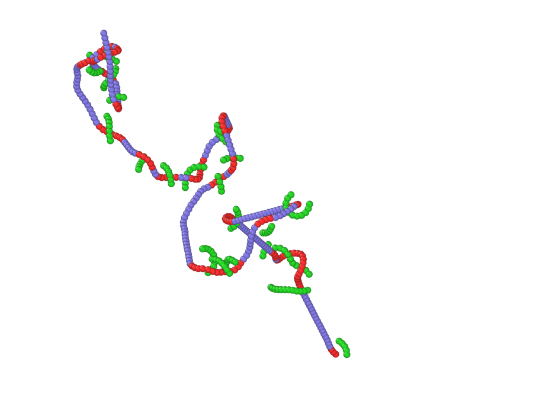

## Example FT-PPA

This directory contains an energy minimized configuration (`dump.PPA_0`) and a reference input script (`input.dat`). 
The system is an equilibrium configuration of the Kremer–Grest model with a chain length of (N = 300) and a bending potential parameter of 2.0. 
Further details of the simulated system can be found in Ref [1](https://doi.org/10.1021/acs.macromol.3c02054).
To run the example, place the `Nexus` executable in the directory and execute the program.

`Nexus` will read the settings specified in `input.dat`. 
The **Command** used in `input.dat` are described in [here](../../docs/FT-PPA.md).

The following results will then be generated sequentially:

1. **`EnNum.DAT`**
   This file contains the average number of entanglements per chain in the system.

2. **`data.chain_1_File_0`**
   This file contains the identified entanglement along chain 1 and the segments (from neighbor chain) entangled with this chain. 
   The file can be imported into visualization software such as [OVITO](https://www.ovito.org/) to generate the visualization shown below.
 

## References

[1] Ruan, Y.; Lu, Y.; An, L.; Wang, Z.-G. *Macromolecules* **2024**, *57(6)*, 2792–2800. https://doi.org/10.1021/acs.macromol.3c02054